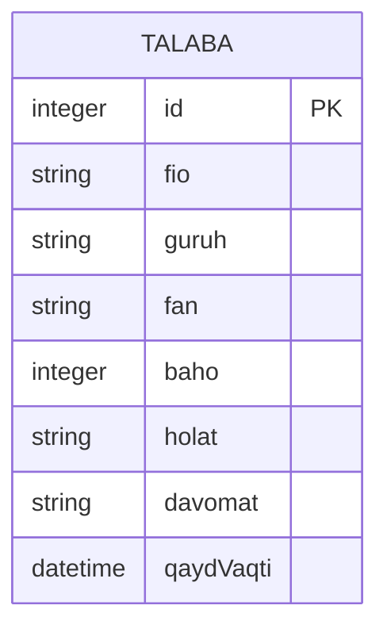

# Elektron dekanat arxitekturasi

| Qatlam | Fayl | Vazifasi |
| --- | --- | --- |
| Taqdimot | index.html, css/style.css, js/app.js | Forma, qidiruv, jadval, statistika va foydalanuvchi hodisalari |
| Biznes mantiqi | js/ombor.js | Kiritmalarni tekshirish, ID berish va CRUD amallari |
| Ma’lumot | localStorage dagi talabalar kaliti | Yozuvlarning JSON massivini saqlash |

## Ma’lumot modeli

| Maydon | Tur va ma’no |
| --- | --- |
| id | Butun son, asosiy kalit |
| fio, guruh, fan | Matn |
| baho | 0–100 oralig‘idagi butun son |
| holat | Faol yoki Nofaol |
| davomat | Qayd etilmagan, Qatnashdi, Qatnashmadi yoki Sababli |
| qaydVaqti | UTC vaqt tamg‘asi |

Bitta entity qo‘llanadi. Guruh va fan shu yozuvning matnli atributlari.
To‘liq JSON Schema `talaba_sxemasi.json` faylida.

## Interfeys maketi

1. Sarlavha va modul nomi.
2. Uchta statistika kartasi.
3. Qo‘shish va tahrirlash uchun bitta forma.
4. Qidiruv va saralash, so‘ng natijalar jadvali.
5. O‘chirish tasdiqlanadigan modal oyna.

### Talaba yozuvining ER modeli

